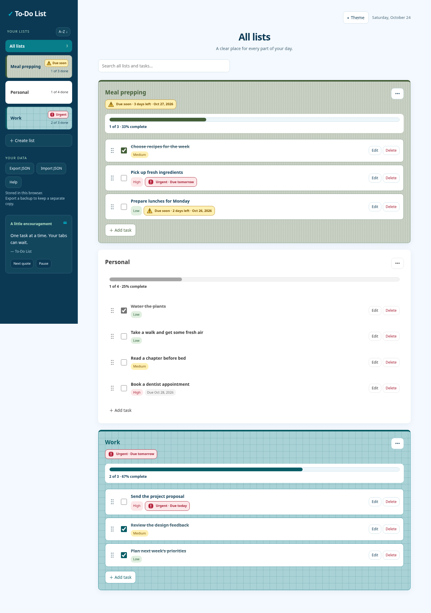
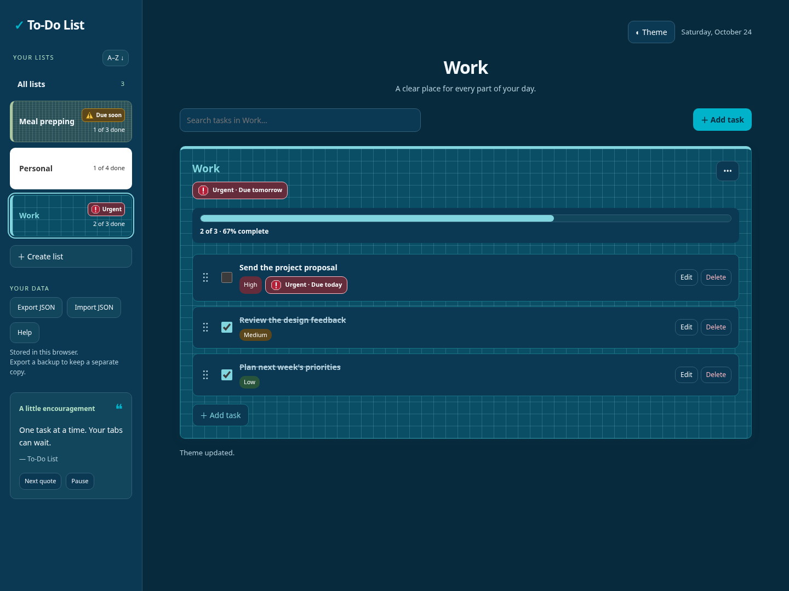
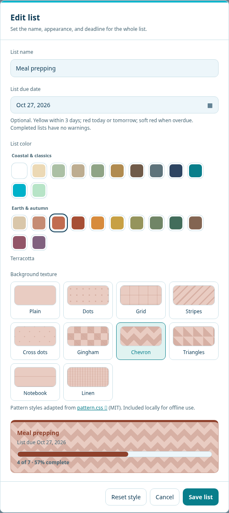
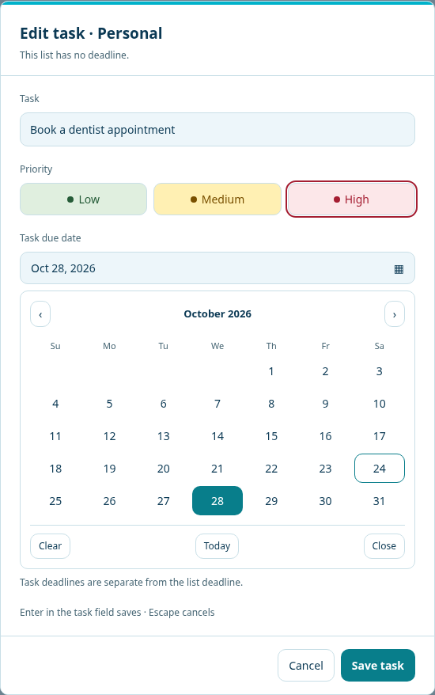
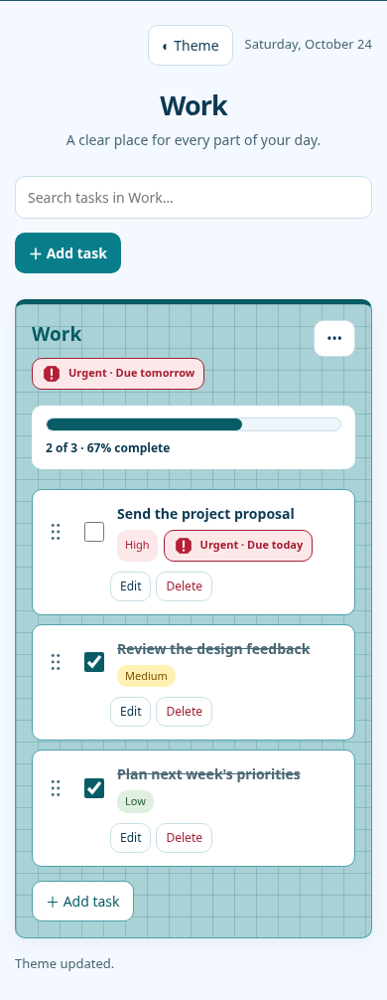

# To-Do List

A clear place for every part of your day.

Organize work, personal plans, and everything in between—with themed lists, useful deadlines, and progress you can actually see.

[](https://github.com/R-Valdina/To-Do-List/actions/workflows/test.yml)
[](LICENSE)
[](src/)

[Features](#features) · [Screenshots](#screenshots) · [Get started](#get-started) · [What changed](#what-changed-and-why) · [Development](docs/DEVELOPMENT.md)



A browser app built with HTML, CSS, and JavaScript. No account, application build step, or backend required.

## Features

### Lists and navigation

Create lists such as Personal, Work, or Meal prepping. Give each one its own name, deadline, color, and background. Edit a list anytime through its ••• → Edit list menu.

- All lists brings your lists together in one workspace.
- The sidebar sorts A–Z or Z–A and repeats each list's theme for easy recognition.
- Search clearly indicates whether it covers all lists or the selected list.

### Task management

Add tasks, edit their descriptions, set priorities and due dates, and mark them complete.

- Drag grips reorder tasks within a list using a mouse or touch.
- Keyboard reordering: focus a grip and use ↑ / ↓; Escape cancels a drag.
- Undo restores the most recently deleted task until dismissed or replaced by another deletion.
- Each list has its own progress bar, with a count and percentage underneath: 1 of 4 · 25% complete. Progress reflects the whole list, even when search hides some tasks.

### Deadlines and priorities

Lists and individual tasks have separate optional due dates. Warnings use text and distinct shapes, as well as color.

| Indicator | Meaning |
| --- | --- |
| Yellow triangle · Due soon | Due in 2–3 days |
| Red octagon · Urgent | Due today or tomorrow |
| Red clock · Overdue | Past its due date; the list or task also gets a soft red background |
| Completed | Deadline warnings are suppressed once the item is complete |

Priorities remain easy to distinguish: red High, yellow Medium, and green Low. Badge labels turn white in dark mode while their backgrounds retain those meanings.

### Appearance

The app uses a navy, teal, cyan, mint, and ice-white theme, with light and dark modes.

- 24 list colors: coastal shades, neutral classics, and 12 earth/autumn tones including Terracotta, Rust, Pumpkin, Golden Ochre, Moss, Cocoa, and Autumn Plum.
- 10 background styles: Plain, Dots, Grid, Stripes, Cross dots, Gingham, Chevron, Triangles, Notebook, and Linen.
- Color and pattern previews match the final list card and sidebar tile.
- White stays white, with white borders and neutral gray text/progress—even when the app is in dark mode. Overdue warnings still take precedence.
- Patterns are included locally; they need no image host or CDN.

### Quotes and help

The sidebar quote card mixes motivational and humorous quotes from [Quotable](https://github.com/lukePeavey/quotable), with original app quotes when the service is unavailable.

Quotes rotate every five minutes while the tab is visible. Choose Next quote for another, or Pause to stop rotation. The app also includes a sidebar Help dialog for shortcuts, backups, editing, and warning explanations.

### Local storage and backups

Lists save automatically as JSON in your browser's local storage. Export JSON downloads a backup; Import JSON validates a backup and asks before replacing your current lists.

There are no accounts, cross-device sync, or automatic server backups. Use the same browser profile and site address to access your lists, and export backups before clearing browser data. This is browser-managed storage, not an automatically maintained JSON/YAML file in a PC folder.

See [data, backups, and privacy](docs/DATA.md) for migration, recovery, the backup format, and details of the optional quote request.

## Screenshots

These are captures of the running app, using disposable example lists and a fixed demo date. They are not design renderings.

### Dark mode



### List themes and task editing

<table>
  <tr>
    <th>Customize the whole list</th>
    <th>Edit a task and choose a date</th>
  </tr>
  <tr>
    <td valign="top"></td>
    <td valign="top"></td>
  </tr>
</table>

<details>
<summary>See the mobile workspace</summary>

The layout adapts to narrow screens. Dialog content scrolls while Save and Cancel remain available. On mobile, sidebar navigation appears above the workspace.



</details>

## Get started

You need Python 3 and a modern browser. Node.js is optional for running the app and required for the unit-test commands.

1. Clone the repository and enter its folder:

   ```sh
   git clone https://github.com/R-Valdina/To-Do-List.git
   cd To-Do-List
   ```

2. If the modernization branch has not been merged into `main`, switch to it:

   ```sh
   git switch codex/modernize-todo-app
   ```

3. Start the local server:

   ```sh
   python3 -m http.server 8000 --bind 127.0.0.1
   ```

4. Open `http://localhost:8000` in your browser and choose Create list.

If your machine uses `python` or `py` instead of `python3`, substitute that command. If Node.js is available, `npm run dev` starts the same server. No `npm install` is needed to run the app or its unit tests.

> Serve the repository over HTTP. Opening `index.html` directly with `file://` does not reliably load JavaScript modules. Keep the same hostname and port to retain access to that origin's saved lists.

The application can also be served by a static host. This repository does not currently provide a desktop installer or a configured public website deployment.

## What changed and why

The project began as a tutorial-inspired JavaScript to-do list with Personal/Business categories, inline task editing, and browser persistence. The updated app keeps that lightweight foundation and expands it into a list-based workspace.

| Earlier behavior | Current behavior | Why it changed |
| --- | --- | --- |
| A task feed with two fixed categories | User-created lists with independent themes, deadlines, and progress | Supports work, personal plans, meals, and other projects without fixed categories |
| Basic completion checkboxes | Visible progress bars plus completed counts and percentages | Makes progress measurable for each list |
| Task order followed creation order | Drag handles and keyboard reordering | Lets people decide what should come next |
| Limited task details | Editable text, priority, and a custom due-date picker | Makes important and time-sensitive work easier to identify |
| Basic visual styling | Consistent app themes, rounded controls, responsive dialogs, and themed list tiles | Makes the interface easier to scan across screen sizes |
| Information repeated around the page | Scoped search labels and an on-demand Help dialog | Keeps the workspace focused while retaining useful guidance |
| Browser storage with no backup workflow | Validated JSON import/export and migration of existing data | Supports recovery and moving lists between browsers |
| Storage and UI behavior shared one JavaScript file | Separate model, storage, dates, themes, and UI modules | Keeps changes smaller and makes behavior easier to test |
| Task text was interpolated into HTML | User text is assigned through DOM text/value properties | Preserves quotes and literal text without turning it into HTML |
| No automated regression suite | Unit tests and real-browser automation in GitHub Actions | Checks that editing, persistence, reordering, themes, and recovery keep working |

The language is still JavaScript. The app uses native ES modules, with no framework, bundler, or production dependency installation. A backend or native desktop shell has not been added.

Existing data from the original app and the latest standalone mockup migrates when available on the same browser origin. Legacy storage keys are retained. See [migration details](docs/DATA.md#existing-data).

## Development and testing

Run the unit suite with Node.js 20+:

```sh
npm test
```

For Chromium automation, install the test-only dependencies in a virtual environment:

```sh
python3 -m venv .venv
. .venv/bin/activate
python -m pip install -r requirements-dev.txt
python -m playwright install chromium
npm run test:browser
```

On Windows, activate with `.venv\Scripts\activate`. Linux may require `python -m playwright install --with-deps chromium`.

Tests cover data validation, migration and recovery, deadlines, list/task editing, mouse/touch/keyboard reordering, progress percentages, responsive dialogs, list appearance, quote rotation, and JSON backups. Browser tests use isolated data and controlled quote responses, so a public API outage does not break CI.

GitHub Actions runs both suites on pushes and pull requests. See the [development guide](docs/DEVELOPMENT.md) for the module layout, test details, and screenshot capture command:

```sh
npm run docs:screenshots
```

## Credits and license

- The original app was inspired by [Learn to Build a Todo List App in 2022](https://www.youtube.com/watch?v=6eFwtaZf6zc).
- Background patterns are adapted from [pattern.css](https://github.com/bansal-io/pattern.css) by bansal-io, under MIT. [Attribution and license details](THIRD_PARTY_NOTICES.md).
- Optional online quotes come from [Quotable](https://github.com/lukePeavey/quotable); author attribution appears in the quote card.
- The project uses the [MIT license](LICENSE).
